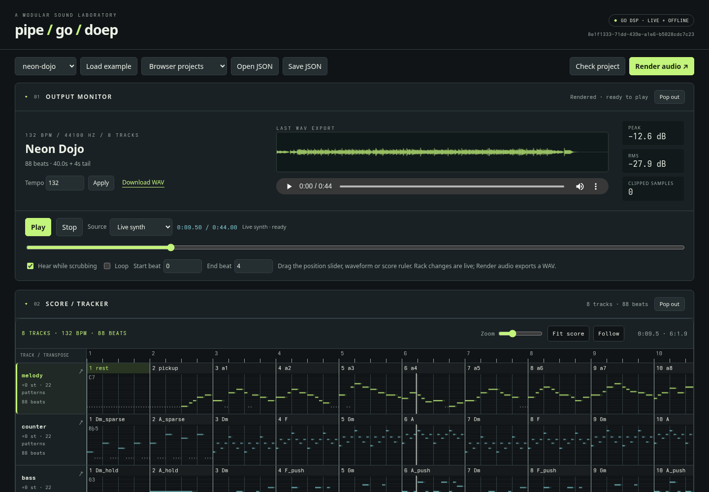
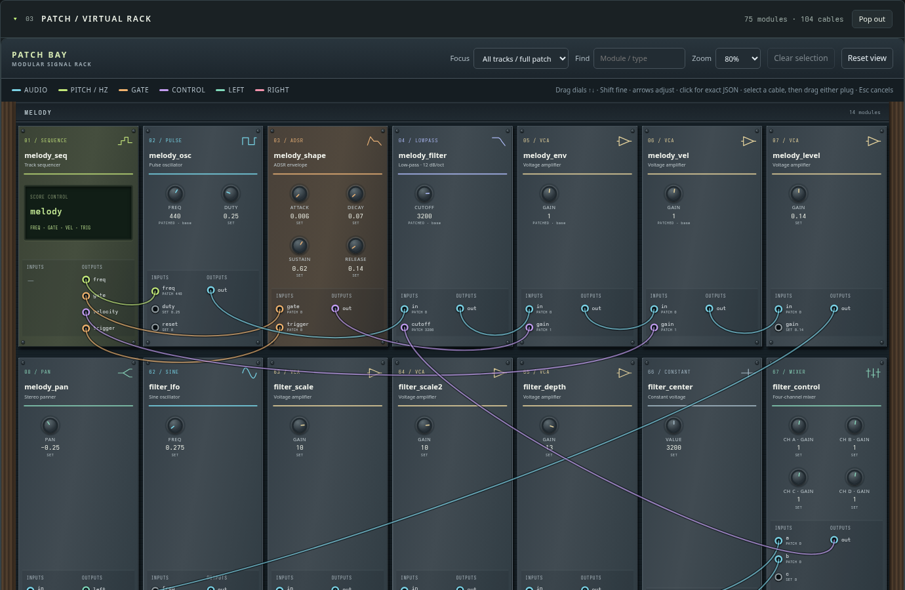

# pipe / go / doep

[](https://github.com/aquarat/pipe-go-doep/actions/workflows/ci.yml)

A small modular synthesiser written in Go. Readable scores and patch cables go in;
original chip music comes out. Includes a local browser workbench, a deterministic
offline renderer, and two compositions exploring a handheld palette and a modern
variation.

**Go engine: standard library only, Go 1.23+. No audio driver, DAW or external samples needed.**





## Listen and experiment

Open **[pipe-go-doep.aquarat.co.uk](https://pipe-go-doep.aquarat.co.uk)** to use the
workbench directly. The same Go engine runs in your browser as WebAssembly, in a
background worker. Projects and audio stay in your browser.

Or run the native workbench from this directory:

```sh
go run ./cmd/pipe-go-doep serve
# Open http://127.0.0.1:8080
```

Choose **lantern-duel** or **neon-dojo** and press **Play** for live synthesis.
Drag the playback slider or score ruler to seek/scrub; set loop boundaries in beats.
Rack controls preview audio as you drag. **Render audio** still creates a WAV for
download or fixed-snapshot playback. Live synthesis needs HTTPS or localhost;
for native localhost, first build its browser assets with `node scripts/build-web.mjs`.
The workbench has separate **tracker/piano-roll score** and **virtual rack patch**
panes, plus a waveform, output meters, tempo control, and WAV/JSON downloads.
The rack shows module controls, type icons, mixer gains and actual patch cables.
Drag a control vertically to adjust it (Shift for fine changes), or click it to
reveal its exact JSON value. Omitted defaults are made explicit when the project
opens. Cable endpoints can be dragged to compatible jacks to reconnect routing.
Modules are sized to their controls, and every cable carries a label along its
path saying what it connects. The rack wraps to show all module instances.

The rack's **oscilloscope** watches any jack while the live synth plays. Drag
from one of its X/Y1–Y4 jacks to a module jack (input or output) or to the stereo
output. YT mode plots up to four signals against time with an edge trigger; XY
mode plots each Y input against X. Probes are saved in the project's `_ui`
metadata and never change the sound.

Each main pane has **Pop out / Pop in** controls. Detached panes remain connected
to the same project; closing their window returns the content to the workbench.
Single rack modules, including the oscilloscope, pop out into their own resizable
windows with the **⧉** tab; a stub with the same jacks keeps their cables in the
rack. The pop-out layout and window positions are saved per project and reopened
on reload (a **Restore windows** button covers windows the browser blocks).
Click a score event or rack module to inspect its source in the JSON tree.

The **JSON pane is collapsed initially**, and its tree branches start collapsed.
Expand fields to inspect/edit values; source mode supports structural edits with
an explicit Apply action. Tree expansion travels in the project's `_ui` metadata.
Each project has a **UUID**: pane visibility and view preferences are saved in
this browser per project, along with its draft. Legacy scores gain an ID on opening.
Use **Browser projects** to switch saved drafts. Loading an example again reopens
its saved browser draft if one exists. Live playback follows edits; the exported
WAV is updated only when rendered again.

For LAN access, run `go run ./cmd/pipe-go-doep serve -addr 0.0.0.0:8080`
and open the host's private IP address, e.g. `http://192.168.1.20:8080`.

Or render directly:

```sh
go install github.com/aquarat/pipe-go-doep/cmd/pipe-go-doep@latest
pipe-go-doep render -o song.wav path/to/score.json

# From a clone of this repository:
go run ./cmd/pipe-go-doep render -o renders/lantern-duel.wav examples/lantern-duel.json
go run ./cmd/pipe-go-doep render -o renders/neon-dojo.wav examples/neon-dojo.json
go run ./cmd/pipe-go-doep validate examples/lantern-duel.json
go run ./cmd/pipe-go-doep graph examples/neon-dojo.json > renders/neon-dojo.dot
```

WAV output is stereo PCM16. Play it with any WAV player, or use the workbench.
Flags precede the score path. `graph` emits Graphviz DOT; Graphviz is optional.

## The patch model

```text
JSON pattern/order ─→ sequence.freq ─→ pulse.freq
                      sequence.gate ─→ ADSR.gate
                      sequence.trigger → ADSR.trigger
                                        ADSR.out ─→ VCA.gain
                                      pulse.out ─→ VCA.in
                                                     ↓
                                                  filter → pan → stereo output
```

Every module exposes named inputs and outputs. A cable connects `node.port` to
`node.port`. Unconnected inputs use defaults, overridden by node parameters.
Signals are floating-point values: audio and modulation share the same pipeline.
A low-frequency oscillator can control pulse width, panning, cutoff, or pitch.
Use mixers for scaling/offsets and combining voices.

- **Sources:** sine, pulse, saw, triangle, 32-step quantized wavetable, LFSR noise.
- **Control:** reusable monophonic tracker patterns, sample-accurate gate/trigger,
  ADSR, constants, VCAs and mixers.
- **Colour/output:** low-pass filter, saturation, bitcrusher/sample hold,
  feedback delay, equal-power stereo pan and explicit stereo routing.

The palette is inspired by Game Boy-era music, including the energy of handheld
fighting games. These are **original compositions**, not transcriptions of
Samurai Shodown. The engine is not a cycle-accurate Game Boy emulator.

## Explore the design

| Path | Purpose |
| --- | --- |
| `internal/score/` | Versioned storage, validation, pitch parsing, pattern scheduling |
| `internal/dsp/` | Small independent signal-processing modules |
| `internal/engine/` | Cable compilation, topological scheduling, WAV encoding/metering |
| `internal/workbench/` | Local/LAN HTTP API and embedded browser application |
| `cmd/pipe-go-doep/` | CLI and atomic file output |
| `cmd/pipe-go-doep-wasm/` | Browser bridge to the same Go engine |
| `worker/` | Cloudflare static hosting and runtime discovery |
| `examples/` | Editable, self-contained compositions |
| `docs/decisions/` | Timestamped architectural decision records |

Start with [workbench guide](docs/workbench.md), [score format](docs/score-format.md),
[module reference](docs/modules.md), [composition notes](docs/compositions.md),
and [architecture](docs/architecture.md).
The [documentation index](docs/README.md) links decisions and extension ideas.

## Develop

```sh
go test ./...
go vet ./...
go build -o bin/pipe-go-doep ./cmd/pipe-go-doep
go test ./internal/engine -bench . -benchmem
```

`mise.toml` pins the locally installed development toolchain. The source targets
Go 1.23. Add a DSP module by implementing `dsp.Module`, registering its factory,
and documenting its ports; the graph scheduler does not need to change.

For the Cloudflare build, use `npm ci && npm run check`. See
[browser renderer](docs/browser-renderer.md) and [deployment](docs/deployment.md)
for WebAssembly, Wrangler, CI and deploying your own copy.

This version supports live browser playback and offline export. MIDI, polyphonic voice
allocation, and arbitrary feedback graphs are future
extensions. See the architecture notes for where they fit.

## License

Copyright (C) 2026 Aaron Scheiner.

pipe / go / doep is free software: you can redistribute it and/or modify it under
the terms of the GNU General Public License as published by the Free Software
Foundation, either version 3 of the License, or (at your option) any later
version. See [LICENSE](LICENSE). The bundled example compositions are covered by
the same license.
